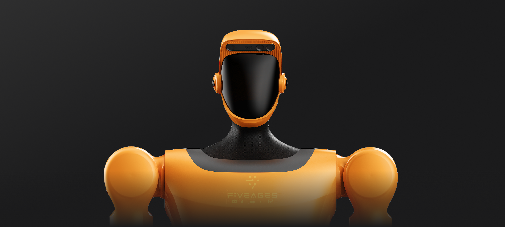
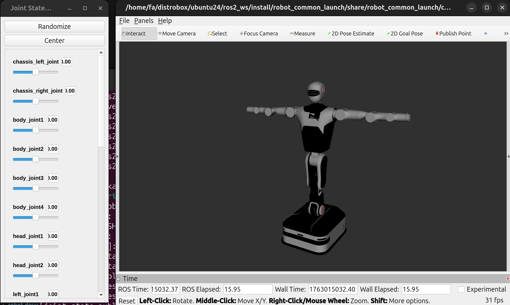

# 第五纪 W2 ROS 2 工作空间



W2（双臂轮式人形）的遥操作与运控工作区：天机 M6-CCS 双臂、LinkerHand L6 / XHand1 灵巧手、Pico 头显（XRoboToolkit）遥操作、Orbbec 头部和腕部相机。源码、驱动、模型都在本仓库，另有两个子模块：`OrbbecSDK_ROS2` 和 `ocs2_ros2`（固定在 `ae75126f0`，升级时改子模块指针并重新验证）。

## 快速开始

Ubuntu 24.04 + ROS 2 Jazzy：

```bash
git clone --recurse-submodules --shallow-submodules git@github.com:wqingzex/ocs2_control.git
cd ocs2_control
./scripts/setup.sh        # 依赖、SDK、编译、相机、手、XR 配对、检查，相机和手弹窗确认
./scripts/start.sh        # 前台启动运控、VR、相机，Ctrl+C 停止
```

- 想用网页操作：编译后双击仓库根目录的 `W2控制台`，它会在后台启动并打开浏览器。
- 容器里同样运行 `./scripts/setup.sh`，只是不执行物理机的 udev 和 CAN 操作。
- 全部命令（单步重试、模块启停、导航、录制、诊断）见 [`scripts/README.md`](scripts/README.md)；遥操作的按键、坐标对齐、故障排查见 [`docs/VR遥操作.md`](docs/VR遥操作.md)。

## 配置

本机配置是 `config/robot.local.yaml`（模板 `config/robot.template.yaml`，说明见 [`config/README.md`](config/README.md)）。最常改的是 `robot` 段：

| 字段 | 取值 |
|---|---|
| `entry` | `whole_body` 全身（默认）、`split_body` 分体（臂 + 腰）、`dual_arm` 双臂 |
| `hand` | `none`、`linkerhand_l6`、`xhand1`（只支持 USB） |
| `hardware` | `real`、`mock_components`、`isaac` |

**通信环境**：部署机器用 RMW Zenoh，避免被局域网里其他设备的 DDS 消息干扰。

```bash
sudo apt install ros-jazzy-rmw-zenoh-cpp
```

环境变量写在 `config/ros_env.sh`（不进 git；`start.sh`、`setup.sh` 和双击启动的控制台都会读，推荐）或 `~/.bashrc`（只对手动打开的终端有效）：

```bash
export RMW_IMPLEMENTATION=rmw_zenoh_cpp
export ROS_DOMAIN_ID=0                    # 0-232，机器人和调试电脑必须一致
# 调试电脑连接机器人上的 Zenoh Router（Client 模式）
export ZENOH_CONFIG_OVERRIDE='mode="client";connect/endpoints=["tcp/192.168.1.100:7447"]'
```

## 编译

`./scripts/setup.sh build-workspace` 增量编译整个工作区（运控、驱动、模型、相机、XR、控制台），自动跳过 `ocs2_ros2` 里不需要的示例包。手动编译：

```bash
rosdep install --from-paths src --ignore-src -r -y
colcon build --symlink-install --packages-up-to robot_bringup \
    juxie_hardware marvin_hardware fiveages_w2_description      # 真机：分体 / 双臂 / 全身
# 只仿真（含 Isaac Sim）：把 juxie、marvin 换成 topic_based_hardware
# 只要双臂：用 split_body / dual_arm 启动即可，全身控制器不会被起
```

## 仿真验证

```bash
ros2 launch robot_visualize humanoid.launch.py    robot:=fiveages_w2          # 全身模型
ros2 launch robot_visualize manipulator.launch.py robot:=m6_ccs type:=dual    # 双臂；type 也可为 right
ros2 launch robot_bringup dual_arm.launch.py       robot:=m6_ccs            # 双臂控制，默认 mock
ros2 launch robot_bringup whole_body.launch.py robot:=fiveages_w2        # 全身 WBC
```



全身控制启动后可用 `mode_command` 切换模式，例如 `ros2 topic pub --once /mode_command std_msgs/msg/String "data: 'BODY_LOCK'"`，命令见 [`whole_body_mpc`](src/robot_control/lib/mpc/whole_body_mpc/README.md)。

## 真机

日常用 `./scripts/start.sh`。手动启动：

```bash
ros2 launch robot_bringup dual_arm.launch.py       robot:=m6_ccs      hardware:=real [type:=linkerhand_l6]   # 双臂
ros2 launch robot_bringup split_body.launch.py robot:=fiveages_w2 hardware:=real [type:=linkerhand_l6]  # 分体
ros2 launch robot_bringup whole_body.launch.py  robot:=fiveages_w2 hardware:=real [type:=linkerhand_l6]  # 全身
```

**远程可视化**：控制节点在机器人上无头运行，RViz 在另一台电脑上。两台机器的 `ROS_DOMAIN_ID` 必须相同，调试电脑按上面的 Client 模式连机器人，并保证 7447 端口通。

```bash
./scripts/start.sh up control                                                              # 机器人上，不起 RViz
ros2 launch robot_bringup split_body.launch.py robot:=fiveages_w2 launch_mode:=rviz_only   # 调试电脑上
```

## 目录结构

```text
ocs2_control/
├─ scripts/       setup.sh（初始化）、start.sh（启动）                       → scripts/README.md
├─ config/        robot.local.yaml 本机配置、robot.template.yaml 模板        → config/README.md
├─ docs/          使用与原理文档、截图                                        → docs/README.md
├─ W2控制台       编译 teleop_app 时生成的启动器，双击打开网页控制台（不进 git）
├─ logs/ run/     运行时生成：各模块日志、模块状态（不进 git）
└─ src/           源码                                                        → src/README.md
```

## 文档

- [`docs/VR遥操作.md`](docs/VR遥操作.md)：部署、启动、按键、相机、录制回放、故障排查
- [`docs/W2_机械臂运动控制原理.md`](docs/W2_机械臂运动控制原理.md)：MPC/MRT、状态机、数值逆解
- 各目录的 README：见上面的"目录结构"和 [`src/README.md`](src/README.md)
