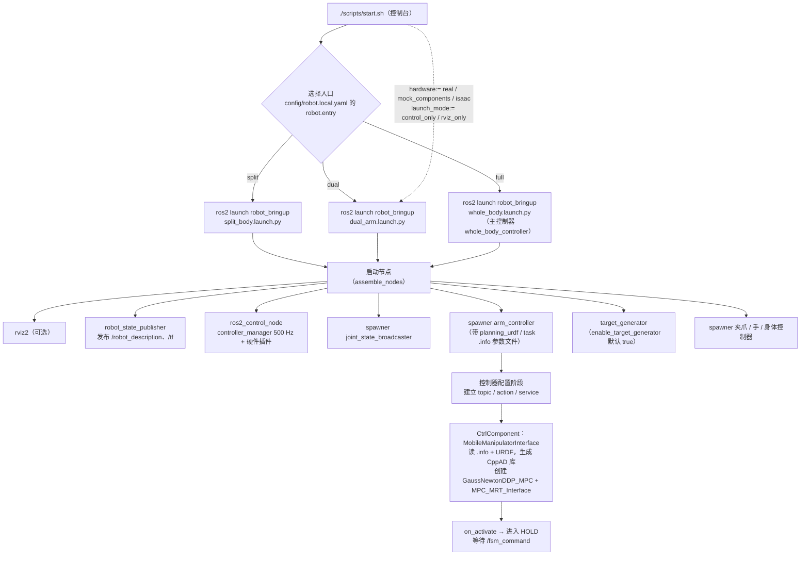
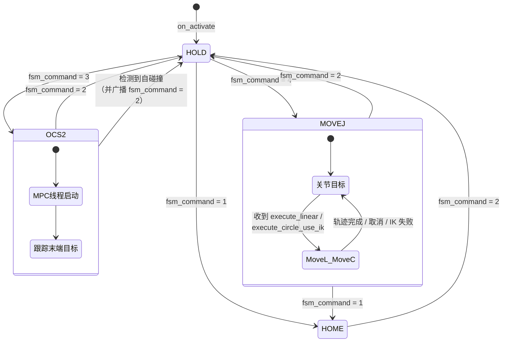
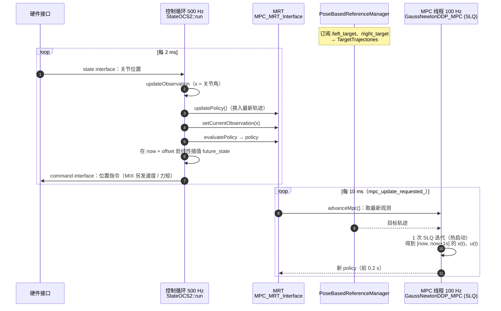
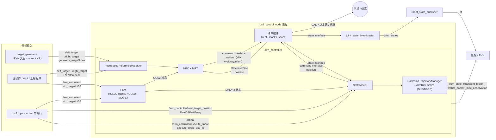
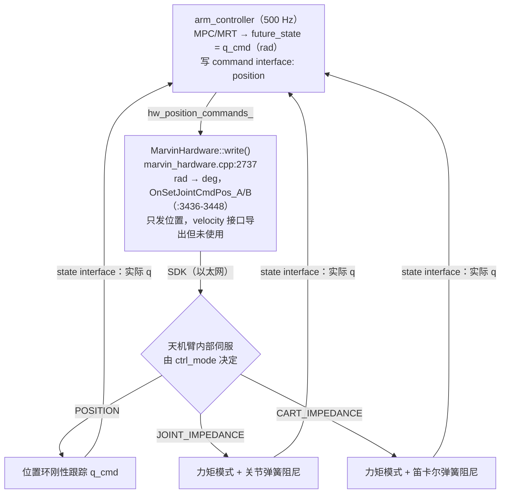

# robot_control_suite 控制原理

> 整理日期：2026-11-08　|　路径均相对 `src/`　|　范围： `arm_controller`、`robot_controller_core`，示例参数取自 fa_w2 的描述包（`robot_description/fa_w2_description`）

robot_control_suite 把末端目标变成关节角的主路径是 **OCS2 MPC**：它直接优化未来 1 s 的关节轨迹，不单独求逆解。
数值 IK（DLS，失败改 BFGS）只用于 MOVEJ 状态下的 MoveL / MoveC，以及外部调用的运动学服务。
天机臂的 POSITION / 阻抗模式位于 MPC 之下，只决定电机如何跟踪 MPC 给出的关节角。

---

## 1. 概览

| 场景 | 方法 | 关节角从哪来 | 所在状态 |
|---|---|---|---|
| 发 `left_target` / `right_target` 话题（遥操作、VLA） | OCS2 MPC 轨迹优化 | `policy.stateTrajectory_` 插值 | OCS2（`fsm_command=3`） |
| 发关节角目标 | 关节空间直接下发 / 插值，不算 IK | 目标关节角本身 | MOVEJ（`fsm_command=4`） |
| MoveL 直线、MoveC 圆弧 | 笛卡尔插补 + 每周期一次 DLS（失败改 BFGS） | `solveSingleArmIKWithInfo` 的解 | MOVEJ（`fsm_command=4`） |
| 外部调用 `KinematicsService` | 同上，一次性求解 | 服务返回值 | 任意（服务常驻） |

---

## 2. 流程图

四张图依次回答：怎么启动、状态怎么切、MPC/MRT 怎么配合、command 和 state 在哪些 topic / 接口上流转。图使用 Mermaid，GitHub、GitLab、VS Code（Markdown Preview Mermaid 插件）可直接渲染。

### 2.1 启动流程



### 2.2 状态机切换（`arm_controller`）



- OCS2 与 MOVEJ 之间**不能直接切换**，必须先发 `2` 回到 HOLD。
- 依据：`StateHold.cpp:12-21`、`StateOCS2.cpp:178-190`、`StateMoveJ.cpp:14-19`、`StateHome.cpp:14-17`（`StateHold`、`StateMoveJ`、`StateHome` 在 `robot_controller_core/src/`，`StateOCS2` 在 `lib/mpc/mpc_core/src/fsm/`）。

### 2.3 MPC / MRT 时序（OCS2 状态内）

MPC 和 MRT 都在 `ros2_control_node` 进程内（`CtrlComponent.h:113-120`），不是独立的 ROS 节点。



### 2.4 Command / State 数据流



要点：

- **控制器内部读 state 不经过 topic**：MPC 和 MOVEJ 直接读 ros2_control 的 state interface，`/joint_states` 只是 `joint_state_broadcaster` 对外广播的副本。
- **command 也不经过 topic**：控制器写 command interface，由硬件插件下发给电机。
- **topic 只用于外部输入和对外监控**：目标位姿、`/fsm_command`、关节目标、action 进入；`/fsm_state`、MPC 观测、`/joint_states`、`/tf` 出去。
- `left_target` / `right_target` 订阅时使用相对名，在默认命名空间下解析为 `/left_target`、`/right_target`。
- `<robot_name>` 取自控制器参数 `robot_name`；`common.yaml` 中出现了 `m6_ccs` 和 `fa_w2` 两处，实际生效值未核实。

### 2.5 控制器与驱动的调用关系

`robot_control`（控制器插件）和 `robot_hardware`（硬件插件）之间没有代码层面的直接调用，只通过 ros2_control 的接口间接连在一起。

```
robot_launch ──启动──▶ ros2_control_node（进程，ros2_control 自带）
                          │ 里面运行着 controller_manager
                          ├─ 加载硬件插件   ← robot_hardware 里的 *_hardware
                          └─ 加载控制器插件 ← robot_control 里的 arm_controller、
                                              whole_body_controller、joint_controller、
                                              end_effector_controller

配置（启动时读一次）
  robot_description   URDF 的 <ros2_control> 里写：硬件插件、关节、接口
  yaml                加载哪些控制器、update_rate

每个周期，controller_manager 按顺序调：① 硬件 read()  ② 控制器 update()  ③ 硬件 write()

  硬件插件 ──state interface（关节位置、速度、力矩）──▶ 控制器插件
  硬件插件 ◀──command interface（目标位置、力矩）────── 控制器插件

硬件插件内部（read()/write() 只和缓存交换数据）
  缓存 ◀──▶ 硬件自己的后台线程（周期性收发，限速限加速也在这里）
                │ 调用
                ▼
  robot_hardware/comm 通信层：只管收发，不含设备协议
    robot_comm_can      CAN   → 关节模组（腰、头）
    robot_comm_serial   串口  → XHand1、KWR75
    robot_comm_modbus   485   → Modbus 夹爪、灵巧手
    robot_comm_core     接口（CanBus / SerialPort / ModbusMaster）

硬件插件：marvin_hardware（臂）、juxie_hardware（腰、头）、end_effector_hardware（末端）、
          topic_based_hardware（仿真）、rokae_hardware（Rokae）
Marvin 臂体走天机 SDK，不经 comm（工具口 485 也走 SDK 的异步收发）
```

**一个控制周期**

1. `controller_manager` 调驱动的 `read()`：驱动把**缓存里最新的**设备反馈放进 state interface。`read()` 本身不碰设备。
2. 调控制器的 `update()`：控制器读 state interface，算完写 command interface。
3. 调驱动的 `write()`：驱动把 command interface 里的值记成"最新目标"，也不直接发给设备。

设备那一头由驱动自己的后台线程负责：按自己的节奏通过通信层收发（CAN 帧、串口、Modbus），把收到的反馈写进缓存，把最新目标限速后发出去。这样控制周期不会被总线 I/O 卡住。例：Juxie 的 `controlLoop` 线程用 `CanBus` 收发，`write()` 只更新 `target_raw_position_commands_`；XHand1 的后台线程用 `SerialPort` 收发，`read()` 在互斥锁下从反馈缓存取数。

**依赖方向**

- 控制器不认识驱动：只按关节名读写接口，不知道关节背后是 CAN、SDK 还是仿真。
- 驱动不认识控制器：只把命令接口记下来、把反馈填进状态接口。
- 两边共用的只有接口名（关节名加 position、velocity、effort 等）和 URDF 里的插件声明。换仿真驱动 `topic_based_hardware`，控制器不用改。
- 设备驱动依赖 `comm/`；`comm/` 不依赖任何驱动。`robot_comm_can`、`robot_comm_serial`、`robot_comm_modbus` 都依赖 `robot_comm_core` 里的接口。

**谁加载谁**：驱动本身不单独启动，`xacro/ros2_control/robot.xacro` 把驱动写进 URDF 的 `<ros2_control>`，`ros2_control_node` 通过 pluginlib 加载；控制器由 `controller_manager` 按 yaml 加载。哪台机器人用哪个驱动，看对应 `*_description` 包。

> 缓存加后台线程的结构只核对了 Juxie 和 XHand1，其他驱动没有逐个确认；`robot_control` 内部各包之间的调用没有画。各包说明见 [`src/robot_hardware/README.md`](../src/robot_hardware/README.md) 和 [`src/robot_control/README.md`](../src/robot_control/README.md)。

---

## 3. 控制器与状态机

### 3.1 加载哪个控制器

由 `config/robot.local.yaml` 的 `robot.entry` 决定（映射见 `robot_app/config.py` 的 `ENTRIES`），三者都基于 OCS2 MPC：

| 入口 | launch 文件 | 主控制器 |
|---|---|---|
| `split` | `split_body.launch.py` | `arm_controller` |
| `dual` | `demo.launch.py` | `arm_controller` |
| `full` | `whole_body.launch.py` | `whole_body_controller` |

### 3.2 状态机（`arm_controller`）

- 激活后默认进入 **HOLD**（`FsmController::on_activate` 里 `startFsm(states_.hold)`），保持当前关节角，MPC 和 DLS 都不运行。
- 通过 `/fsm_command`（`std_msgs/Int32`）切换（`StateHold.cpp:12-21`）：

| `fsm_command` | 状态 | 关节角怎么来 |
|---|---|---|
| 1 | HOME | 回零位，关节空间插值 |
| 3 | OCS2 | MPC，订阅 `left_target` / `right_target` |
| 4 | MOVEJ | 关节目标直接下发；MoveL/MoveC 走 DLS |

```bash
ros2 topic pub --once /fsm_command std_msgs/msg/Int32 "{data: 3}"   # 进入 MPC
```

### 3.3 MoveJ / MoveL / MoveC 的层级

使用上它们是三种并列的运动指令（与工业机器人惯例一致），但代码里不在同一层：

```
FSM 状态（互斥）
├── HOLD (默认)
├── HOME  (1)
├── OCS2  (3)  ← MPC
└── MOVEJ (4)
     └── motion_mode_（StateMoveJ.h:143）
          ├── MotionMode::MOVEJ          ← 关节角目标
          ├── MotionMode::MOVECARTESIAN  ← MoveL / MoveC 共用
          │     ├── PathType::LINE   → MoveL
          │     └── PathType::CIRCLE → MoveC
          └── MotionMode::WAIST_CONTROL
```

- 和 OCS2 状态平级的是 **MOVEJ 状态**；MoveL/MoveC 是它的子功能，必须先进入 MOVEJ。
- MoveL 与 MoveC 共用 `CartesianTrajectoryManager` 和同一套 IK，只是路径形状不同。
- 同一时刻只跑一种；笛卡尔运动执行中，关节目标被忽略（`StateMoveJ.cpp:583`）。

### 3.4 MOVEJ 状态的入口

| 功能 | 接口 | 类型 |
|---|---|---|
| 关节角目标 | 话题 `/arm_controller/joint_target_position`（另有左/右/身体/头分话题） | `std_msgs/Float64MultiArray` |
| 多点关节轨迹 | action `joint_trajectory_with_para` | `JointTrajectory.action` |
| MoveL | action `/arm_controller/execute_linear` | `ExecuteLinear.action`（`LinearMessage`） |
| MoveC | action `/arm_controller/execute_circle_use_ik` | `MovecUseIK.action`（`CircleMessage`） |

- MoveL 目标：终点位姿 `endpoint`（双臂另有 `right_endpoint`）、速度/加速度/加加速度限制或 `duration`、`arm_name`、`ik_type`。
- MoveC 目标：三点法（中间点 + 终点）或参数法（圆心 + 旋转轴 + 角度），可选 SLERP 姿态插值。
- 起点都由当前关节角经 FK 算出，无需给出。
- 不在 MOVEJ 状态时请求被拒绝（`StateMoveJ.cpp:2950`）。
- 中途中止：客户端取消、停止回零抢占、离开 MOVEJ 状态、某帧 IK 失败。

```bash
ros2 topic pub --once /fsm_command std_msgs/msg/Int32 "{data: 4}"
ros2 action send_goal /arm_controller/execute_linear \
  robot_control_msgs/action/ExecuteLinear \
  "{linear_params: {endpoint: {position: {x: 0.4, y: 0.2, z: 0.3}, orientation: {w: 1.0}},
    time_mode: true, duration: 2.0, arm_name: 'left', ik_type: 'AUTO'}}" --feedback
```

（坐标仅为示意，需填工作空间内可达位姿；该命令未在机器上验证。）

### 3.5 MoveJ 与 MoveL/MoveC：区别在插值空间

| | MoveJ | MoveL | MoveC |
|---|---|---|---|
| 输入 | 目标关节角 | 末端终点位姿 | 中间点 + 终点（或圆心/轴/角） |
| 插值空间 | 关节空间 | 笛卡尔空间 | 笛卡尔空间 |
| 末端路径 | 不确定曲线 | 直线 | 圆弧 |
| 每周期算 IK | 否 | 是 | 是 |
| 奇异点风险 | 无 | 有 | 有 |
| 典型用途 | 回零、大范围换姿、轨迹回放 | 插入、贴面推、直线抓取 | 绕圆、擦拭、拧转 |

同一种运动内部还有"插值曲线"的选择：MoveJ 用 `none / linear / tanh / doubles`；MoveL/MoveC 用速度/加速度/加加速度限制或 `duration`。

---

## 4. MPC 路径

### 4.1 输入与输出

| | 内容 | 来源 / 去向 |
|---|---|---|
| 输入 1：观测 | 时间 t，状态 x = 当前关节角 | `CtrlComponent::updateObservation`，读编码器（`CtrlComponent.cpp:70-72`） |
| 输入 2：目标 | 左/右末端目标位姿 | `left_target`、`right_target`（及 `/stamped`），经 `PoseBasedReferenceManager`（`:85-120`）转成 `TargetTrajectories` |
| 输出：policy | 未来 1 s 的 x(t)（关节角）和 u(t)（关节速度） | MRT 在 500 Hz 控制循环插值，下发位置指令（MIX 模式另发速度与静力矩） |

- `observation_.input` 被置零（`CtrlComponent.cpp:74`），MPC 只知道位置，不知道当前速度。
- 延迟补偿：距上次下发不到 `hardware_latency_` 且开启 `cached_ob_state_` 时，用上次指令代替反馈作为观测（`CtrlComponent.cpp:94-99`）。

### 4.2 优化问题

- 状态 x = 关节角 q；输入 u = 关节速度 q̇；模型为运动学积分器 ẋ = u（不含动力学）。
- 维度随 `.info` 文件而变：全身控制的 `whole_body_fixed_*.info` 为 20（4 腰 + 7 左 + 7 右 + 2 头），双臂控制的 `dual_arm_*.info` 为 14。

```latex
\min_{u(\cdot)} \int_{t}^{t+T} \big[ L_{input}(u) + L_{ee}(x) + L_{limits}(x,u) + L_{collision}(x) \big]\, d\tau + \Phi_{ee}\big(x(t+T)\big)
```

| 项 | 配置段 | 作用 | fa_w2 参数 |
|---|---|---|---|
| L_input = ½uᵀRu | `inputCost` | 惩罚关节速度，平滑并抑制奇异 | R = 1e-3·I |
| L_ee | `endEffector` | 过程中的末端位姿误差（Pinocchio FK） | 位置 μ=10，姿态 μ=5 |
| Φ_ee | `finalEndEffector` | 时域终点末端误差，权重更大 | 位置 μ=20，姿态 μ=10 |
| 关节位置限位 | `jointPositionLimits` | 松弛对数障碍软约束 | μ=1e-2，δ=1e-3 |
| 关节速度限位 | `jointVelocityLimits` | 同上 | 腰 ±0.5 rad/s，臂 ±1.07 rad/s |
| 自碰撞 | `selfCollision` | 连杆距离 ≥ `minimumDistance` | `whole_body_fixed_*.info` 中启用 |

末端位姿是代价项而非硬约束：目标不可达时给出折中解，不会失败。

### 4.3 求解：SLQ（Gauss-Newton DDP）

控制器使用 `GaussNewtonDDP_MPC`（`CtrlComponent.cpp:10`），`ddp.algorithm SLQ`。每次迭代：

1. **前向 rollout**：从当前 x₀ 按上次控制律积分 ẋ = u，得到名义轨迹（ODE45）。
2. **线性化 + 二次化**：动力学一阶展开；代价二阶展开，Hessian 用 Gauss-Newton 近似；末端误差雅可比由 CppAD 自动微分生成（所以首次启动要编译动态库）。
3. **反向 Riccati 传播**：从终点往回解 Riccati 方程得到 δu，线搜索选步长（1e-2 ~ 1.0）后更新轨迹。

### 4.4 实时配置

| 配置 | 含义 |
|---|---|
| `maxNumIterations 1` | 每次只做 1 次 SLQ 迭代（实时迭代 RTI） |
| `coldStart false` | 热启动，用上次解作初值 |
| `mpcDesiredFrequency 100` | 每 10 ms 重新求解 |
| `nThreads 3` | 多线程线性化 |
| `preComputeRiccatiTerms true` | 预计算 Riccati 项 |
| `useFeedbackPolicy false` | 只用前馈轨迹，不用反馈增益 |
| `solutionTimeWindow 0.2` | 只把前 0.2 s 的解交给 MRT |

### 4.5 MPC 与 MRT

| | MPC（求解器） | MRT（执行器） |
|---|---|---|
| 做什么 | 解优化问题，产出 policy | 取最新 policy，在当前时刻插值出指令 |
| 在哪跑 | `StateOCS2::mpcUpdateThread` → `advanceMpc()` | 控制循环 → `evaluatePolicy()` |
| 频率 | 100 Hz | 跟随控制循环 500 Hz |

MRT 经 `setCurrentObservation()` 把观测交给 MPC，经 `updatePolicy()` 换入新轨迹；MPC 偶尔变慢时，控制循环继续沿用旧 policy。

### 4.6 求出的是整条轨迹，插值只是取点

SLQ 的优化变量就是整个时域的轨迹，时域按 `ddp.timeStep = 1e-3` 离散（约每 1 ms 一个节点）：

```
policy.timeTrajectory_  = [t0, t1, ..., tN]   // t0 = now, tN ≈ now + 1s
policy.stateTrajectory_ = [x0, x1, ..., xN]   // 每个时刻的关节角
policy.inputTrajectory_ = [u0, u1, ..., uN]   // 每个时刻的关节速度
```

- now+1s 只是轨迹终点，承载终端代价。
- 插值的作用是对齐时刻：控制循环在 `now + future_time_offset_ / frequency` 处，用 `LinearInterpolation::interpolate` 在相邻两个节点之间取值（`CtrlComponent.cpp:118-128`）。

```
MPC 第 k 次（0ms）： ●━━━━━━━━━━━━━━━━━━━━━━━━━━━━━━━━━● 1s 轨迹
                    └─ 前 0.2s 交给 MRT ─┘
控制循环取点：       ↑ ↑ ↑ ↑ ↑    （每 2ms 插值一个点）
MPC 第 k+1 次（10ms）：  ●━━━━━━━━━━━━━━━━━━━━━━━━━━━━━━━━━● 新轨迹替换旧轨迹
```

---

## 5. DLS 数值 IK 路径

### 5.1 调用入口

- MoveL：`CartesianTrajectoryManager.cpp:574`，每周期插补器 `planner->run()` 给出下一个末端位姿，调用 `solveSingleArmIKWithInfo(pose, current_joint_pos, ..., 50)`。
- MoveC：`CartesianTrajectoryManager.cpp:624`，同上。
- 服务：`ArmController` 的 `kinematics_service` → `computeInverseKinematics`（`Kinematics.cpp:1326`）。

### 5.2 求解器选择（`Kinematics.cpp:137-205`）

- `AUTO`：先 DLS，失败后 BFGS。
- 也可通过消息 `ik_type` 指定 `DLS` 或 `BFGS`。

### 5.3 DLS 迭代（`Kinematics.cpp:208-290`）

1. 用当前 q 做 FK，读末端位姿 `data_.oMf[frameId]`。
2. `compute6DError` 算 6 维误差；范数 < 容差（默认 1e-4）即成功。
3. 计算雅可比 J。
4. 求增量（`dampedLeastSquares`，`:293`）：

```latex
\Delta q = (J^\top J + \lambda I)^{-1} J^\top e
```

5. 阻尼 λ 随 J 条件数增大，上限 0.1（`computeAdaptiveDamping`，`:304`）。
6. 步长限制 ‖Δq‖ ≤ 0.3。
7. `q += Δq`，再截断到关节限位。
8. 误差连续 8 次几乎不降 → 判定停滞失败。

### 5.4 BFGS 兜底（`Kinematics.cpp:962` 起）

- 带关节限位的梯度投影 BFGS + Armijo 线搜索。
- 可加正则 λ‖q − q_seed‖² 让解靠近初值；可开随机重启。
- 比 DLS 慢，但对冗余臂和贴近限位更稳。

### 5.5 起点来源

MoveL 每周期把上一帧 IK 解作为下一帧初值（`CartesianTrajectoryManager.cpp:589`：`current_joint_pos = solution;`），只有启动时用真实关节位置。这是开环做法：跟踪误差感知不到，但轨迹连续、不受传感器噪声影响。

---

## 6. 下层伺服：天机臂控制模式

MPC 与天机臂（marvin）控制模式是**上下级关系**：MPC 每 2 ms 给出关节角目标 q_cmd；POSITION / 关节阻抗 / 笛卡尔阻抗是臂控制器内部的伺服律，决定电机怎样跟踪 q_cmd。无论哪种模式，ROS 下发的都只有关节位置。

### 6.1 分层



### 6.2 各模式（`marvin_hardware.cpp:960-1030`）

| ctrl_mode | SDK 设置 | 对 q_cmd 的处理 | 参数 |
|---|---|---|---|
| `POSITION`（fa_w2 默认） | `OnSetTargetState(1)` | 刚性跟踪，外力下不让步 | xacro `max_joint_speed=50`、`max_joint_acceleration=30` |
| `JOINT_IMPEDANCE` | `OnSetTargetState(3)` + `OnSetImpType(1)` + `OnSetJointKD(K,D)` | q_cmd 作为弹簧平衡点，近似 τ ≈ K(q_cmd − q) − D·q̇ + 重力/动力学补偿 | `joint_k_gains` 默认 `[2,2,2,1.6,1,1,1]`，`joint_d_gains` 默认 0.4 |
| `CART_IMPEDANCE` | `OnSetTargetState(3)` + `OnSetImpType(2)` + `OnSetCartKD(K,D,type)` | 平衡点仍由 q_cmd 决定，弹簧作用在末端笛卡尔空间 | `cart_k_gains` 默认 `[1800×3, 40×3, 20]`，`cart_d_gains` |
| `POWER_OFF` | `OnSetTargetState(0)` | 下使能；操作抱闸前必须处于此模式 | — |

阻抗公式只是示意，SDK 内部控制律与 K、D 的单位在代码中不可见。

### 6.3 对 MPC 的影响

1. **MPC 不感知下层模式**：模型 ẋ = u 假设"给什么关节角就到什么关节角"，POSITION 模式下基本成立。
2. **阻抗模式下 MPC 输出是柔顺参考**：受外力时实际 q 偏离 q_cmd（偏多少由 K 决定），下一拍 MPC 从偏离后的反馈重新规划——闭环成立，但 MPC 不显式建模外力。K 越小越柔顺，跟踪误差越大。
3. **延迟补偿需谨慎**：开启 `cached_ob_state_` 时会用上次指令代替反馈，在阻抗模式下会掩盖真实偏离。
4. **两层限速**：MPC `jointVelocityLimits`（臂 ±1.07 rad/s）与 SDK `max_joint_speed` / `max_joint_acceleration`；SDK 更严时实际运动比规划慢，表现为跟踪滞后。
5. **ROS 侧 PD 对天机臂不生效**：`StateOCS2::enter()`（第 52-75 行）只在 `ControlMode::MIX` 下写 `joint_kp/kd`，MIX 还会下发速度和静力矩；但 marvin 只导出 position/velocity 指令接口，且 `write()` 只用位置。这套接口面向支持 MIT 模式（位置 + 速度 + kp/kd + 前馈力矩）的电机，如 juxie 关节（未逐个核对插件）。 fa_w2 的 `common.yaml` 只配置了 `position` 指令接口，当前走 POSITION 分支。

### 6.4 切换方式

- **启动时**：xacro 参数 `arm_ctrl_mode`，默认 `position`（`robot_description/fa_w2_description/xacro/ros2_control/robot.xacro:5`），可由平台 profile（`config/robot.local.yaml`）传入。
- **运行时**：修改硬件参数 `ctrl_mode`（`marvin_hardware.cpp:713`），插件重新 activate 并下发新模式；抱闸释放时只允许切到 `POWER_OFF`。

一句话：MPC 决定"去哪儿、怎么走"，天机臂控制模式决定"用多硬的方式去"。

---

## 7. MPC 与 DLS 对比

根本区别：DLS 只解当前这一个时刻的关节角；MPC 解未来一段时间的整条轨迹，并考虑约束。

| 维度 | DLS | MPC |
|---|---|---|
| 求解问题 | 找一个 q 使 FK(q) ≈ 目标 | 找 [t, t+T] 内的 q(t)、u(t) 使累计代价最小 |
| 时间维度 | 无，瞬时点 | 有预测时域，模型 q̇ = u |
| 约束 | 每步后截断限位 | 位置/速度限位、自碰撞进入优化 |
| 平滑性 | 依赖上游插补 | 速度代价保证平滑 |
| 冗余自由度 | 解取决于初值 | 由代价统一决定 |
| 奇异点 | 增大阻尼硬扛 | 速度代价自然抑制 |
| 目标不可达 | 返回失败，MoveL 中止 | 给出最接近的折中轨迹 |
| 计算量 | 小 | 大，独立线程运行 |
| 实时结构 | 控制周期内同步调用 | MPC 低频求解 + MRT 高频插值 |
| 起点 | 上一帧 IK 解（开环） | 编码器反馈（闭环，带延迟补偿） |

分工理由：

- **MoveL/MoveC 用 DLS**：路径已由插补器定好，每帧只需精确逆解；MPC 的代价权衡反而会偏离路径。
- **话题目标用 MPC**：目标实时、带噪、可能跳变或超出工作空间，需要平滑、安全和约束处理。

---

## 8. 基础概念

### 8.1 q 是什么

q 是关节位置向量（广义坐标），单位 rad。

- DLS 中：单臂 7 维，`Kinematics.cpp:214` `Eigen::VectorXd q = seed;`。
- MPC 中：即状态 x，维度见 4.2；`future_state(i)` 直接作为第 i 个关节的位置指令（`CtrlComponent.cpp:133-136`），输入 u 为关节速度。

### 8.2 奇异点

由 ẋ = J(q)·q̇，当 J 掉秩（某奇异值趋近 0）时，末端在某方向失去运动能力，称为奇异点。

- 常见情况：手臂伸直（肘奇异）、两关节轴共线（腕奇异）、末端位于肩部轴线上。
- 危害：q̇ = J⁻¹ẋ 会放大误差，小的末端位移要求关节极快转动，导致抖动或冲击。
- 应对：DLS 按条件数加大阻尼；MPC 通过速度代价自然抑制。

### 8.3 预测时域 T 与各频率

T 是预测时域（秒），不是控制频率。

| 参数 | 值 | 含义 |
|---|---|---|
| `mpc.timeHorizon` | 1.0 s | 预测时域 T |
| `ddp.timeStep` | 1e-3 s | 求解器离散步长 |
| `mpc.mpcDesiredFrequency` | 100 Hz | MPC 重新求解频率 |
| `mpc.mrtDesiredFrequency` | 400 Hz | MRT 使用 policy 频率 |
| `rollout.timeStep` | 1e-2 s | 前向积分步长 |
| `update_rate`（`common.yaml`） | 500 Hz | ros2_control 控制循环频率 |

调参直觉：T 越长越平滑但响应越"懒"、计算量越大；MPC 频率越高对新目标反应越快；控制频率只决定指令下发的细腻程度。

---

## 9. 注意事项与未核实项

**注意事项**

- **MOVEJ 不插值**：fa_w2 配置 `movej_interpolation_type: none`（`common.yaml`），关节目标下一周期即原样下发（`StateMoveJ.cpp:620-645`）。目标离当前位置远时会要求电机一步跳过去，需发送方自行发密集平滑轨迹，或改为 `linear / tanh / doubles`（代码默认 `tanh`）。
- **MoveL 不检查速度和碰撞**：DLS 只截断关节位置；插补步长过大或经过奇异区附近时，相邻帧解可能跳变，MoveL 的速度和加速度参数不宜激进。
- **MPC 有跟踪滞后**：由 `future_time_offset_` 和 MPC 频率决定。

**未核实**

- 各启动入口实际加载哪个 `.info` 文件（由 `info_file_name` 和 launch 模式决定，`robot_utils.py:365`），因此 MPC 状态维度未逐一确认。
- `whole_body_controller`（`full` 入口）的初始状态和切换逻辑未查看。

---

## 10. 代码索引

| 内容 | 位置 |
|---|---|
| 控制器注册与 FSM 初始状态 | `robot_control/arm_controller/src/ArmController.cpp`、`robot_control/robot_controller_core/src/FsmController.cpp` |
| HOLD 状态切换 | `.../robot_controller_core/src/StateHold.cpp:12-21` |
| MPC 线程 | `.../mpc_core/src/fsm/StateOCS2.cpp:110-146` |
| 观测、policy 插值、指令下发 | `.../arm_controller/src/control/CtrlComponent.cpp:61-160` |
| 末端目标订阅 | `robot_control/lib/mpc/mpc_core/src/reference/PoseBasedReferenceManager.cpp:85-120` |
| MOVEJ 状态（关节目标 / MoveL / MoveC） | `robot_control/robot_controller_core/src/StateMoveJ.cpp` |
| MotionMode 定义 | `.../robot_controller_core/include/robot_controller_core/StateMoveJ.h:143` |
| 笛卡尔插补 + 调 IK | `.../trajectory_manager/src/CartesianTrajectoryManager.cpp:574, 589, 624` |
| DLS / BFGS 实现 | `.../robot_dynamics/src/Kinematics.cpp:137-325, 962, 1326` |
| MoveL/MoveC 消息定义 | `robot_control/robot_control_msgs/msg/LinearMessage.msg`、`CircleMessage.msg` |
| MPC 参数 | `robot_description/fa_w2_description/config/ocs2/whole_body_fixed_*.info`、`dual_arm_*.info` |
| 控制器参数 | `robot_description/fa_w2_description/config/ros2_control/common.yaml` |
| 启动入口 | `config/robot.local.yaml` 的 `robot.entry`（`robot_app/config.py` 的 `ENTRIES`） |
| 天机臂控制模式与写入 | `robot_hardware/marvin_hardware/src/marvin_hardware.cpp:713, 960-1030, 2675-2760, 3436-3448` |
| 天机臂 ctrl_mode 启动参数 | `robot_description/fa_w2_description/xacro/ros2_control/robot.xacro:5`、`robot_description/component/m6_ccs_description/xacro/ros2_control/marvin_hardware.xacro:49` |
