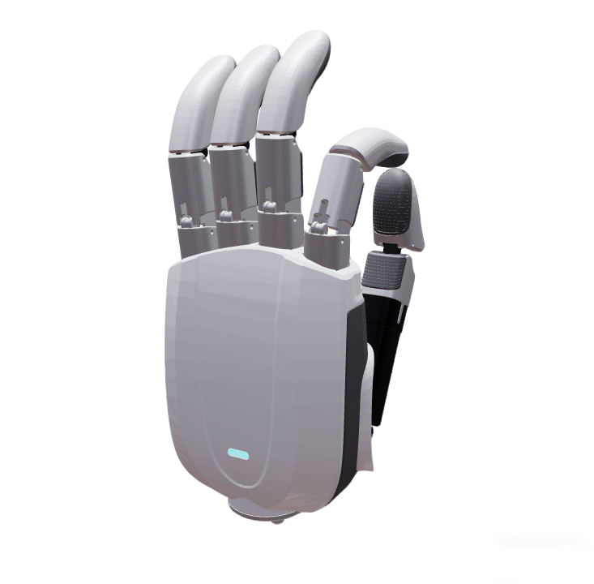

# linkerhand_description

LinkerHand **L6**（6 自由度灵巧手）的 URDF 和 `ros2_control` 描述。其他型号（O6 / O7 / L10）已移除。原始文件来自 [linkerhand-urdf](https://github.com/linker-bot/linkerhand-urdf)。



## 使用

`direction:=1` 为左手（默认），`-1` 为右手。

```bash
ros2 launch robot_visualize hand.launch.py hand:=linkerhand type:=l6                   # 看模型
ros2 launch robot_startup hand.launch.py type:=l6                             # mock 控制
ros2 launch robot_startup hand.launch.py hand:=linkerhand type:=l6 hardware:=real direction:=1   # 真机
```

整机上用 `end_effector:=linkerhand_l6`，见 [m6_ccs](../m6_ccs_description/README.md#末端执行器)。

## 真机

`end_effector_hardware` 驱动，Modbus RTU：115200、8N1，功能码 04（读输入寄存器）和 16（写保持寄存器）。从站号：左手 `0x28`，右手 `0x27`，必须与 `direction` 对应。串口用 `serial_port:=/dev/ttyUSB0`。

连接超时的排查：

1. 从站号是否匹配 `direction`；
2. `ls -l /dev/ttyUSB*` 看串口和权限，`sudo lsof /dev/ttyUSB0` 看是否被占用；
3. 直接读寄存器：`mbpoll -m rtu -b 115200 -a 40 -r 0 -c 6 /dev/ttyUSB0`（左手；右手 `-a 39`）。
