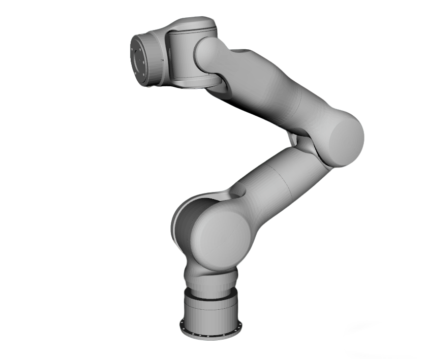

# m6_ccs_description

天机 Marvin M6-S CCS 双臂的描述包，同时是**末端和 `ros2_control` 共享宏**的所在：fa_w2 的双臂规划模型和末端也复用这里（fa_w2 双臂的 `.info` 在它自己的包里）。



## 使用

```bash
ros2 launch robot_visualize manipulator.launch.py robot:=m6_ccs collider:=simple     # 看模型（双臂）
ros2 launch robot_startup dual_arm.launch.py robot:=m6_ccs                         # 控制，默认 mock
ros2 launch robot_startup dual_arm.launch.py robot:=m6_ccs hardware:=real end_effector:=linkerhand_l6
```

| 场景 | 做法 |
|---|---|
| 单臂 | `arms:=left` 或 `arms:=right`（默认 `dual`） |
| 末端 | `end_effector:=<名字>`（和 `robot.end_effector.type` 相同：`jodell_rg75` / `linkerhand_l6` / `xhand1` / `wuji_hand2` / `none`）；左右不同用 `left_end_effector` / `right_end_effector` 覆盖一侧；不传时用 `robot_profile` 里的 `robot.end_effector.type` |
| 展台 | `variant:=desktop`（臂间距 ±0.12 m，OCS2 `dual_arm_eef_desktop.info`），与末端正交，见 [docs/m6_ccs_dual_desktop.md](docs/m6_ccs_dual_desktop.md) |
| 臂外观 | `skin:=fa_w2` 用 fa_w2 的外观网格；碰撞始终用 `meshes/link*.glb` |

`robot.local.yaml` 也可配 `defaults.end_effectors.left` / `.right`。

## OCS2 `.info`

`arm_controller` 按 `info_file_name` 从本包 `config/ocs2/` 选一份，命名规则同 [fa_w2](../../fa_w2_description/README.md#info-命名)（「范围_坐标系_变体」）：

| 文件 | 用于 |
|---|---|
| `dual_arm_eef.info` | 双臂，默认值 |
| `dual_arm_tcp.info` | 双臂，跟踪 TCP |
| `dual_arm_eef_desktop.info` | `variant:=desktop`（`config/ros2_control/desktop.yaml`） |
| `single_arm_tcp.info` | 单臂 `arms:=left` / `right`（`left.yaml` / `right.yaml`） |

## 末端执行器

目前支持两种灵巧手和一种夹爪，类型映射在 `xacro/eef_type_resolver.xacro`：

| 键 | 产品 | 臂体 RS485（`marvin`） | 外接 USB（`usb`） |
|---|---|:--:|:--:|
| `linkerhand_l6` | LinkerHand L6 | 支持 | 支持 |
| `xhand1` | XHand1（带法兰，安装偏移 4.5 mm） | — | 支持 |
| `rg75` | Jodell RG75-300 夹爪（描述在 [`jodell_description`](../jodell_description/README.md)） | 支持（仿真已验证，真机未验证） | 未接 |

夹爪关节是 `left_gripper_joint` / `right_gripper_joint`，控制器是 `end_effector_controller/GripperController` 实例；`rg75` 的标定负载（`dyn_param`）已内置在 `xacro/eefs.xacro`。每条臂下面还有一个虚拟的 `<side>_tcp_offset` 坐标系（TCP 偏移，默认 0），用启动参数 `left_tcp_offset_xyz/rpy`、`right_tcp_offset_xyz/rpy` 设置，不会移动手或夹爪的模型。

真机每侧独立选驱动：`left_end_effector_bus` / `right_end_effector_bus`。`hardware:=real` 时默认走 `marvin`（臂体 RS485，`marvin_hardware`）；外接 USB 末端传 `left_ee_drive_type:=usb` / `right_ee_drive_type:=usb`（`robot_app` 按 `robot.end_effector.interface.bus` 自动传）。`tianji_can`（臂体 CAN）只保留在 xacro 里，目前没有末端使用。

## 真机配置

`robot.local.yaml`：

```yaml
robot:
  variant: desktop                           # 可选
  arm: {type: marvin, interface: {ip: 192.168.10.190}}
  end_effector:
    type: linkerhand_l6
    interface:
      bus: usb_rs485
      left:  {port: /dev/serial/by-id/usb-…}
      right: {port: /dev/serial/by-id/usb-…}
control:
  arm_mode: joint_impedance
  limits: {max_joint_speed: 50, max_joint_acceleration: 30}
```

写在 `robot.local.yaml` 里的这些项会变成 xacro 参数 `device_ip`、`arm_ctrl_mode`、`max_joint_speed`、`max_joint_acceleration`、`usb_left_port` / `usb_right_port`、`left_dyn_param` / `right_dyn_param`（对照见 `config/README.md`）。启动时也可以用 `hardware_<xacro 参数名>:=…` 临时覆盖，没有写进配置文件的调参项（如 `left_ee_rw_rate`）也只能这样传。

## 共享宏（`xacro/ros2_control/`）

`robot.xacro` 是薄封装，下面的模块也被 `fa_w2_description` include：

| 文件 | 宏 | 作用 |
|---|---|---|
| `interfaces.xacro` | `m6_interfaces` | 单臂 7 自由度关节接口 |
| `end_effector_interfaces.xacro` | `side_hand_interfaces`、`dual_arm_ee_block` | 末端接口 |
| `marvin_hardware.xacro` | `marvin_hardware_block` | Marvin 插件参数（含 `ee_dyn_param`） |
| `external_ee_systems.xacro` | `external_ee_systems`、`side_usb_hand_system` | 外接 USB-RS485 末端，左右串口由 `./scripts/setup.sh ee` 配置为对应的 `/dev/serial/by-id/…` |
| `simulation_hardware.xacro` | `simulation_hardware_plugin` | 仿真硬件插件：mock / isaac |

URDF 层复用 `eef_type_resolver.xacro`、`eefs.xacro`（`ee_dyn_param`）、`arm_mount.xacro`（`DualArmMount`，默认间距 ±0.062 m）。
