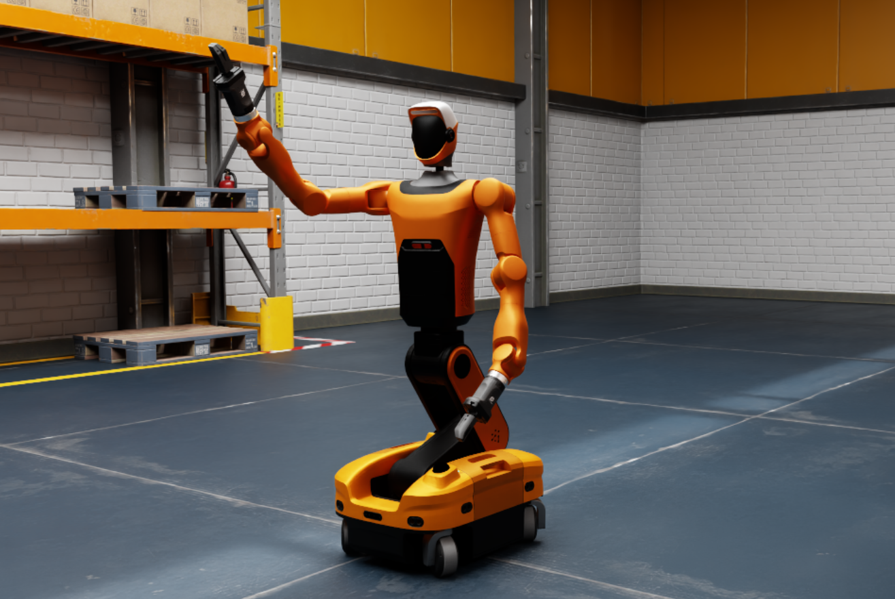

# fa_w2_description

第五纪 fa_w2（轮式人形）整机描述：xacro 模型、`ros2_control` 配置、OCS2 配置。



## 作用

本包只组装整机，零件在 [`component/`](../component/README.md)：

| 部分 | 来源 |
|---|---|
| 底盘（`linkhou_s2_v2`，默认；或 `linkhou_s2`） | [`linkhou_s2_description`](../component/linkhou_s2_description/README.md)，参数 `base` |
| 躯干、头 | [`fa_w2_body_description`](../component/fa_w2_body_description/README.md)、[`fa_w2_head_description`](../component/fa_w2_head_description/README.md)，参数 `variant`（头限位：`stand` / `v1.5`） |
| 双臂（`skin:=fa_w2`）、末端、`ros2_control` 宏 | [`m6_ccs_description`](../component/m6_ccs_description/README.md) |

规划 URDF 默认冻结底盘轮关节和末端关节。

## 使用

```bash
ros2 launch robot_visualize humanoid.launch.py robot:=fa_w2 collider:=simple end_effector:=linkerhand_l6   # 看模型
./scripts/start.sh                                                                                                  # 整机启动（日常用这个）
ros2 launch robot_startup whole_body.launch.py  robot:=fa_w2 end_effector:=linkerhand_l6                # 全身，默认 mock
ros2 launch robot_startup split_body.launch.py robot:=fa_w2 end_effector:=linkerhand_l6                # 分体：腰、头、臂各自的控制器
ros2 launch robot_startup head_body.launch.py    robot:=fa_w2                                    # 只有腰和头
```

腰、头的 CAN FD 口默认 `can0`，换口在 `config/robot.local.yaml` 的 `hardware:` 下写 `body_can_interface: can1`（真机模式生效；改完重新运行 `./scripts/setup.sh host`，让免密 sudo 规则用同一个名字，名字只允许 1 到 15 个字母、数字、`_`、`.`、`-`）。

夹爪：`end_effector:=jodell_rg75`（左右各一个 Jodell RG75，仿真和 M6 双臂上都验证过）。TCP 偏移：`left_tcp_offset_xyz` / `left_tcp_offset_rpy` / `right_tcp_offset_xyz` / `right_tcp_offset_rpy`（默认 `0 0 0`）。头部关节限位默认是宽限位（±1.3963 rad），旧的窄限位用 `variant:=wheel_V1.0`。

加 `hardware:=isaac` 用 Isaac 仿真，`hardware:=real` 接真机（末端接法由 `left_end_effector_bus` / `right_end_effector_bus` 决定，`robot_app` 按 `robot.end_effector.interface.bus` 传）。左右不同末端用 `left_end_effector` / `right_end_effector`（不要再传 `type`），末端说明见 [m6_ccs](../component/m6_ccs_description/README.md#末端执行器)。

## 内容

| 路径 | 作用 |
|---|---|
| `xacro/robot.xacro`、`xacro/ros2_control/robot.xacro` | 运动学模型、加硬件的模型（薄封装，宏在 m6_ccs） |
| `config/ros2_control/common.yaml` | 控制器参数：`whole_body_controller`（全身）、`arm_controller`（双臂）、`body_joint_controller`、`head_joint_controller` 等，包括归位姿态 `home_1`~`home_4`；机器人包只有这一个默认文件（手的包用 `ros2_controllers.yaml`） |
| `config/ocs2/*.info` | MPC 配置，命名和可选值见下方 [`.info` 命名](#info-命名)；改关节速度惩罚、限速在这里 |
| `xacro/ros2_control/body.xacro` | 腰和头的 Juxie 硬件接口 |

### `.info` 命名

文件名是「范围_坐标系_变体」，控制器用参数 `info_file_name` 选一份（不带 `.info`）。

| 段 | 取值 | 含义 |
|---|---|---|
| 范围 | `whole_body_fixed` / `whole_body_mobile` | `whole_body_controller` 加载：腰 + 双臂 + 头，固定底盘 / 移动底盘 |
| | `dual_arm` / `single_arm` | `arm_controller` 加载：只有手臂 |
| 坐标系 | `eef` / `tcp` | 跟踪法兰（`left_eef`、`right_eef`）还是工具中心点（`left_tcp`、`right_tcp`） |
| 变体 | `l6` / `xhand` / `desktop` …（可省略） | 按机台调的参数（末端型号）或安装方式 |

本包里的文件：

| 文件 | 控制器 | 说明 |
|---|---|---|
| `whole_body_fixed_eef_l6.info` | `whole_body_controller` | 默认值；L6 机台参数 |
| `whole_body_fixed_tcp_l6.info` | `whole_body_controller` | L6 机台参数，跟踪 TCP |
| `whole_body_fixed_eef_xhand.info` / `whole_body_fixed_tcp_xhand.info` | `whole_body_controller` | XHand1 机台参数（取自 fa_gen2_ws） |
| `whole_body_mobile_tcp.info` | `whole_body_controller` | 移动底盘 |
| `dual_arm_eef.info` / `dual_arm_tcp.info` | `arm_controller` | 双臂 / 分体控制；规划模型是 `m6_ccs` 的双臂 URDF（`robot_name: m6_ccs`），`.info` 用 `info_package: fa_w2_description` 从本包读 |

本机选哪一份写在 `robot.local.yaml` 的 `control.patch.<控制器>.ros__parameters.info_file_name`。新增一套参数：复制一份改名，再在本机配置里指过去，重新编译本包。

## 真机

真机拆成两个 system：臂和末端走 `marvin_hardware`（`arms`），腰和头走 `juxie_hardware`（`juxie_body`，`body_joint1~4`、`head_joint1~2`）；外接 USB 末端走 `end_effector_hardware`。仿真合并为一个 system（mock / isaac）。

`robot.local.yaml` 里的 `hardware:` 段在 `real` 时注入 xacro：

```yaml
hardware:
  device_ip: 192.168.1.190
  arm_ctrl_mode: position
  max_joint_speed: 50
  max_joint_acceleration: 30
  usb_left_port: /dev/ttyUSB0
  usb_right_port: /dev/ttyUSB2
```

启动时可用 `hardware_<键>:=…` 覆盖，如 `hardware_device_ip:=…`、`hardware_usb_left_port:=…`。

