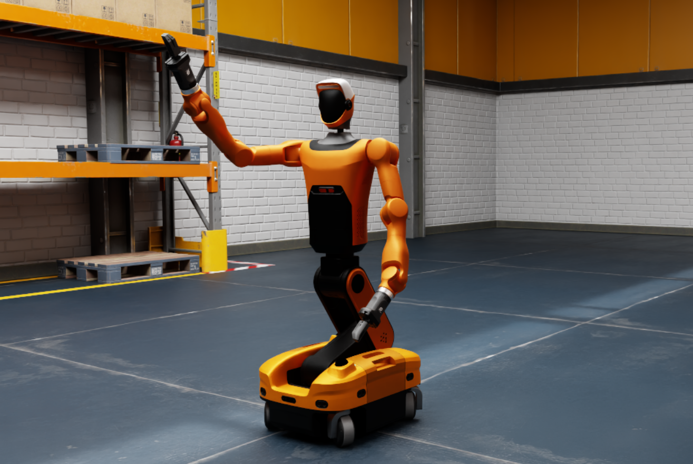

# fiveages_w2_description

第五纪 W2（轮式人形）整机描述：xacro 模型、`ros2_control` 配置、OCS2 配置、导航路由。



## 作用

本包只组装整机，零件在 [`component/`](../component/README.md)：

| 部分 | 来源 |
|---|---|
| 底盘（`linkhou_s2_v2`，默认；或 `linkhou_s2`） | [`linkhou_s2_description`](../component/linkhou_s2_description/README.md)，参数 `chassis` |
| 躯干、头 | [`w2_body_description`](../component/w2_body_description/README.md)、[`w2_head_description`](../component/w2_head_description/README.md)，参数 `variant`（头限位：`stand` / `v1.5`） |
| 双臂（`skin:=fiveages_w2`）、末端、`ros2_control` 宏 | [`m6_ccs_description`](../component/m6_ccs_description/README.md) |

规划 URDF 默认冻结底盘轮关节和末端关节。

## 使用

```bash
ros2 launch robot_visualize humanoid.launch.py robot:=fiveages_w2 collider:=simple type:=linkerhand_l6   # 看模型
./scripts/start.sh                                                                                                  # 整机启动（日常用这个）
ros2 launch robot_bringup whole_body.launch.py  robot:=fiveages_w2 type:=linkerhand_l6                # 全身，默认 mock
ros2 launch robot_bringup split_body.launch.py robot:=fiveages_w2 type:=linkerhand_l6                # 分体：腰、头、臂各自的控制器
ros2 launch robot_bringup head_body.launch.py    robot:=fiveages_w2                                    # 只有腰和头
```

腰、头的 CAN FD 口默认 `can0`，换口在 `config/robot.local.yaml` 的 `hardware:` 下写 `body_can_interface: can1`（真机模式生效；改完重新运行 `./scripts/setup.sh host`，让免密 sudo 规则用同一个名字，名字只允许 1 到 15 个字母、数字、`_`、`.`、`-`）。

夹爪：`type:=rg75`（左右各一个 Jodell RG75，仿真和 M6 双臂上都验证过）。TCP 偏移：`left_tcp_offset_xyz` / `left_tcp_offset_rpy` / `right_tcp_offset_xyz` / `right_tcp_offset_rpy`（默认 `0 0 0`）。头部关节限位默认是宽限位（±1.3963 rad），旧的窄限位用 `variant:=wheel_V1.0`。

加 `hardware:=isaac` 用 Isaac 仿真，`hardware:=real` / `real_usb` 接真机。左右不同末端用 `left_type` / `right_type`（不要再传 `type`），末端说明见 [m6_ccs](../component/m6_ccs_description/README.md#末端执行器)。

## 内容

| 路径 | 作用 |
|---|---|
| `xacro/robot.xacro`、`xacro/ros2_control/robot.xacro` | 运动学模型、加硬件的模型（薄封装，宏在 m6_ccs） |
| `config/ros2_control/common.yaml` | 控制器参数：`whole_body_controller`（全身）、`arm_controller`（双臂）、`body_joint_controller`、`head_joint_controller` 等 |
| `config/ocs2/*.info` | MPC 配置，控制器按参数 `info_file_name` 选一份（全身默认 `fixed_base`，`robot.local.yaml` 可覆盖，如 `fixed_base_tcp`）；改关节速度惩罚、限速在这里 |
| `xacro/ros2_control/body.xacro` | 腰和头的 Juxie 硬件接口 |
| `config/maps/`、`config/nav2/` | 导航地图（`siemens`、`siemens_task2`、`wind_turbo_task1`）、Nav2 参数和行为树 |

## 真机

真机拆成两个 system：臂和末端走 `marvin_hardware`（`M6_CCS_System`），腰和头走 `juxie_hardware`（`juxie_body`，`body_joint1~4`、`head_joint1~2`）；外接 USB 末端走 `modbus_hardware`。仿真合并为一个 system（mock / isaac）。

`robot.local.yaml` 里的 `hardware:` 段在 `real` / `real_usb` 时注入 xacro：

```yaml
hardware:
  device_ip: 192.168.1.190
  arm_ctrl_mode: position
  max_joint_speed: 50
  max_joint_acceleration: 30
  usb_left_port: /dev/ttyUSB0
  usb_right_port: /dev/ttyUSB2
```

启动时可用 `hardware_<键>:=…` 覆盖，如 `hardware_device_ip:=…`、`hardware_usb_left_port:=…`。

## 导航

`./scripts/start.sh nav` 或 `ros2 launch robot_navigation navigation_isaac_gt.launch.py robot:=fiveages_w2 map:=siemens_task2`。点云话题 `/fl_lidar/point_cloud`、`/rr_lidar/point_cloud`（见 `nav2_params_isaac_gt.yaml`）。地图和参数在本包的 `config/maps/`、`config/nav2/`，`map` 可写文件夹名、绝对路径或 `文件夹/map`，`./scripts/start.sh nav --list` 列出地图，不指定时用第一张。详见 [`robot_navigation`](../../robot_launch/robot_navigation/README.md)。
